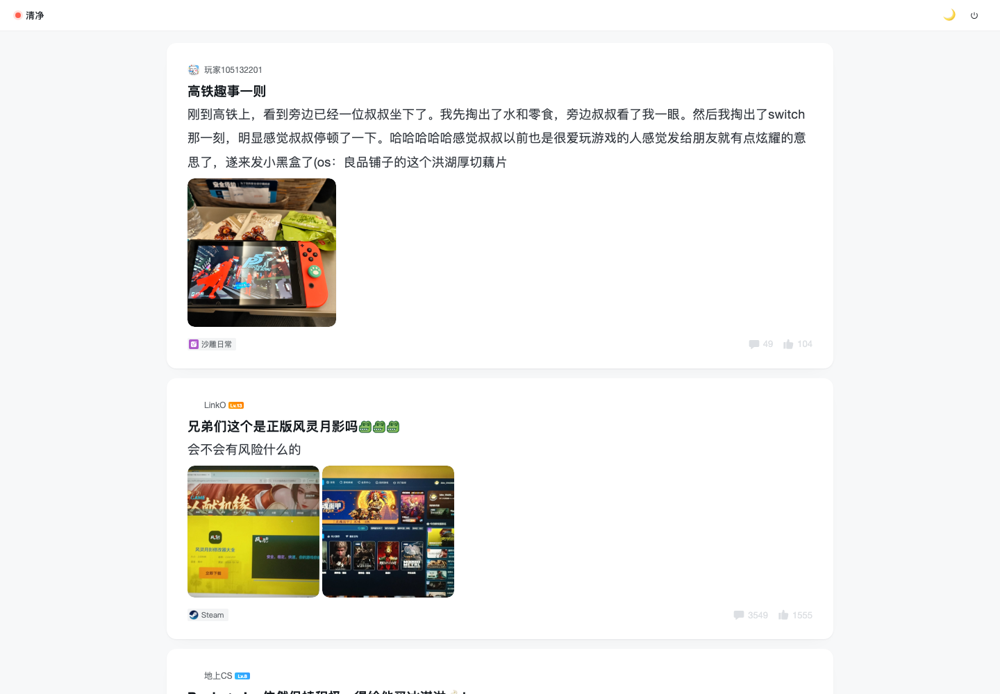
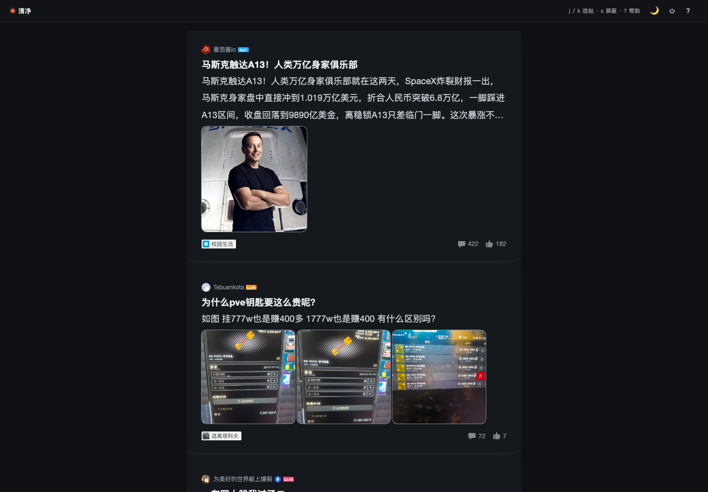
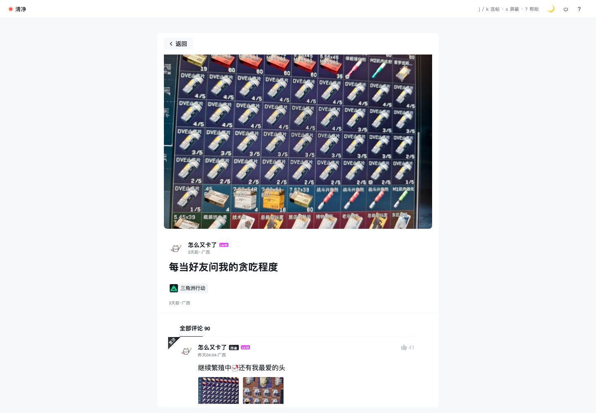

# 小黑盒 · 清净模式

把[小黑盒网页版](https://www.xiaoheihe.cn/app/bbs/home)变成一块安静的阅读板：去掉顶栏、侧栏、下载二维码、悬浮推广，只留帖子流。Chrome 扩展（Manifest V3），纯本地运行，零依赖零构建。



## 特性

- **单列卡片阅读**：时间线拆成独立卡片（圆角/投影/悬停浮起），列宽自适应屏幕（宽屏最多 960px），详情页恒定 760px 阅读行宽
- **自定义顶栏**：品牌位 + 夜间/日间切换 + 回原版，半透明毛玻璃
- **三套主题**：浅色 / 夜间 / 纸色，跟随系统或手动
- **已读管理**：点过的帖子变淡（可切换为直接隐藏），最多记 2500 条
- **屏蔽**：关键词列表；按住 `Alt` 点作者名直接屏蔽
- **布局开关**：搜索框、话题横条、右侧栏想看哪个开哪个——侧栏打开时自动切两栏布局
- **零残留**：总开关关掉（或禁用扩展）后，页面 100% 回到原版





## 安装

1. 从 [Releases](../../releases) 下载 `xiaoheihe-chill.zip` 并解压
2. Chrome 地址栏输入 `chrome://extensions`，右上角打开「开发者模式」
3. 点「加载已解压的扩展程序」，**选解压出的 `xiaoheihe-chill` 文件夹**（不是 zip）
4. 打开小黑盒，完事

更新版本后：扩展页点卡片上的 ↻ 重新加载，或重启 Chrome。

## 隐私

不联网、不上报、无远程代码。权限只有 `storage`（同步你的净化设置）和 `*.xiaoheihe.cn`（仅在该站点注入）。所有处理都在你的浏览器里完成。

## 开发

```
xiaoheihe-chill/
├── manifest.json    # MV3 配置
├── content.css      # 全部样式，挂在 html.xhh-on 下
├── content.js       # 设置应用、已读/屏蔽、顶栏、空时间线提示
├── shared.js        # 默认设置（content 与 popup 共用）
├── popup.html/css/js
├── background.js    # 仅维护工具栏徽标状态
└── icons/
```

改完代码：`chrome://extensions` → 卡片上的 ↻ → 刷新页面。

## License

[MIT](LICENSE)
